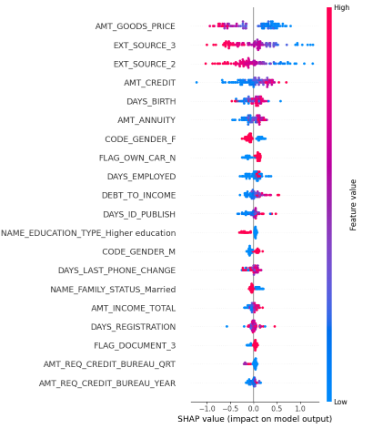
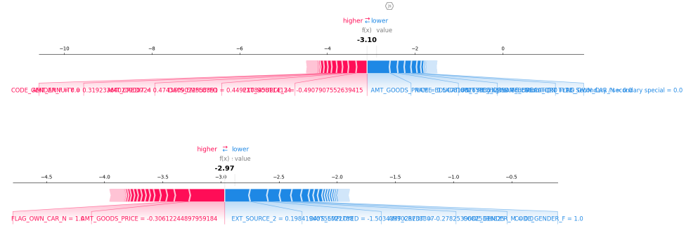

# Home Credit Default Risk

Loan-default classification with a fitted scikit-learn preprocessing pipeline, XGBoost, a FastAPI prediction API, and per-prediction SHAP explanations.

## Results and scope

The original notebook reports **0.7466 ROC-AUC**. This is a historical experiment result, not a guarantee for a newly trained artifact. The training command below writes its own held-out score, seed, and split sizes to `models/metrics.json`.

Earlier materials included an illustrative $850K annual savings estimate. It is **not measured customer or production impact**; the financial assumptions have not been independently validated. This repository is an educational credit-risk demonstration, not a lending decision system.

## Reproduce locally

Use Python 3.11 or newer, from the repository root:

```bash
git clone https://github.com/mustafaoun/home-credit-default-risk.git
cd home-credit-default-risk
python -m venv .venv
source .venv/bin/activate
pip install -r requirements-dev.txt
```

On Windows activate with `.venv\Scripts\activate`. Obtain `application_train.csv` from the [Home Credit Default Risk competition](https://www.kaggle.com/competitions/home-credit-default-risk/data), subject to its terms, and place it in `data/raw/`. The raw dataset and trained artifact are not bundled.

```bash
python -m src.ml.train --data data/raw/application_train.csv --output-dir models
uvicorn src.api.app:app --host 127.0.0.1 --port 8000
```

Training splits raw rows before selecting columns. Numeric preprocessing and category vocabularies are fitted on the training set. An 80/20 stratified holdout produces the reported score. This standalone baseline is not an exact reproduction of every notebook experiment.

## Try the API

```bash
curl http://localhost:8000/health
curl http://localhost:8000/schema
curl -X POST http://localhost:8000/predict -H 'Content-Type: application/json' --data-binary @models/example_request.json
```

Interactive API documentation: <http://localhost:8000/docs>.

`/schema` describes the loaded artifact's required input fields. `/predict` accepts `{"features": {...}}`; use the generated example rather than inventing a partial payload. Missing required fields and invalid numeric values return HTTP 422. Engineered debt-to-income and missing-employment fields can be derived when their source fields are supplied. Extra fields are ignored.

The response contains default probability, threshold, prediction, and SHAP contributions mapped to the transformed features. For binary XGBoost these contributions explain the raw model score (log odds), not percentage-point changes in probability. `DECISION_THRESHOLD` defaults to 0.12 for continuity with the original experiment; choose and validate a threshold against business costs before any operational use.

`MODEL_PATH` can override the default `models/model.pkl`. Only load trusted artifacts: joblib files can execute code. Startup fails clearly if the artifact is absent.

## Docker

Train the model first, then build from the repository root:

```bash
docker build -f deploy/Dockerfile -t home-credit-api .
docker run --rm -p 8000:8000 home-credit-api
```

The image contains the trained artifact. It does not download data or train during startup.

## Verification

```bash
pytest -q
```

Tests train a small synthetic classifier and exercise actual prediction and SHAP computation, schema validation, missing artifacts, and the training-to-serving path. They do not reproduce the full Kaggle score or measure production latency.

## Project evidence

- [Original experiment notebook](notebooks/W2.ipynb)
- [Model card](docs/MODEL_CARD.md)
- [Architecture](docs/ARCHITECTURE.md)




Monitoring, authentication, fairness evaluation, threshold calibration, and prospective business validation remain future work.
